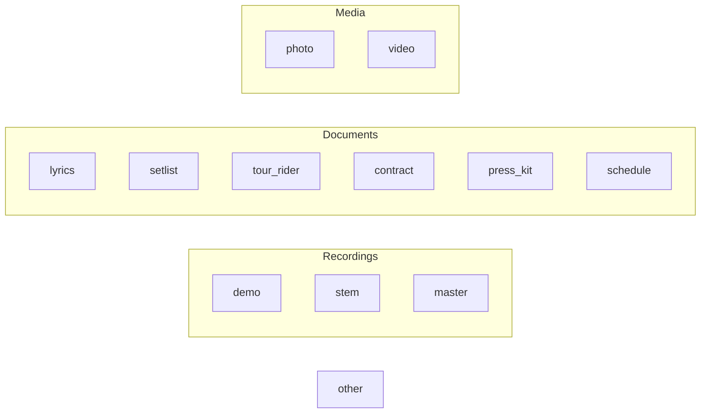

# Content types & metadata

SNAP Records stores label/band work product as `content_items`. Each item has a **category** (what it is), an **audience_level** (who it is for by default), optional **embargo timestamps**, and a file on the volume.

## Categories

| Category | Typical files | Default audience (suggested) | Notes |
|----------|---------------|------------------------------|--------|
| `demo` | Rough mixes, work tapes | `band` or `press` | Unreleased recordings |
| `stem` | Instrument/vocal stems | `band` | Often shared with producers (press/partner or grant) |
| `master` | Final masters | `band` or `press` | Embargo via `available_from_press` |
| `lyrics` | Text/PDF lyrics | `band` or `fan_club` | |
| `setlist` | Show setlists | `crew` | Crew-visible |
| `tour_rider` | Technical/hospitality riders | `crew` | May hold sensitive fees later (field encryption deferred) |
| `contract` | Agreements | `band` or `restricted` | Sensitive; prefer `restricted` + grants |
| `photo` | Stills | `press` or `public` | Press kits often bundle these |
| `video` | Clips, BTS | `fan_club` or `press` | |
| `press_kit` | Zip/PDF kits | `press` | Use press availability window |
| `schedule` | Tour/rehearsal schedules | `crew` | Crew-oriented |
| `other` | Catch-all | `band` | Prefer a real category when possible |

## Category groups (for UI and crew rules)

**Crew-oriented categories** (see [ACCESS_CONTROL.md](ACCESS_CONTROL.md)): `schedule`, `setlist`, `tour_rider`, plus any item with `audience_level = crew`.

## Audience levels

Defined on the item; independent of category but categories suggest defaults.

| Level | Intent |
|-------|--------|
| `public` | Safe for any registered user |
| `fan_club` | Pre-release / BTS / early announcements for subscribers |
| `press` | Embargoed press material |
| `crew` | Tour/production logistics |
| `band` | Internal to the act |
| `restricted` | Named users via grants only |

## Per-item metadata

| Field | Purpose |
|-------|---------|
| title | Display name |
| description | Optional context |
| category | Taxonomy above |
| audience_level | Default access tier |
| available_from_press | Embargo for press-tier access |
| available_from_fans | Embargo for fan-club-tier access |
| is_public | Shortcut / flag consistent with `audience_level = public` when true |
| mime_type, size_bytes, original_filename | File facts |
| storage_path | Location on volume |
| checksum_sha256 | Integrity check (optional in Phase 2) |
| band_id | Owning band (SNAP for now) |
| uploaded_by_user_id | Auditor / attribution |

## Example items (seed ideas for Phase 2)

| Title | Category | Audience | Windows |
|-------|----------|----------|---------|
| SNAP — Album X master | `master` | `press` | `available_from_press` = release − 7 days |
| SNAP — Demo reel | `demo` | `band` | none |
| Tour EU 2026 rider | `tour_rider` | `crew` | none |
| Fan BTS clip #1 | `video` | `fan_club` | `available_from_fans` set |
| Public single artwork | `photo` | `public` | none |
| Sync license draft | `contract` | `restricted` | grant to specific partner |

## Upload form fields (Phase 2)

Required: file, title, category, audience_level (band fixed to SNAP for now).  
Optional: description, available_from_press, available_from_fans, is_public.

## Related docs

- [DATA_MODEL.md](DATA_MODEL.md)  
- [ACCESS_CONTROL.md](ACCESS_CONTROL.md)  
- [PAGES.md](PAGES.md)  
