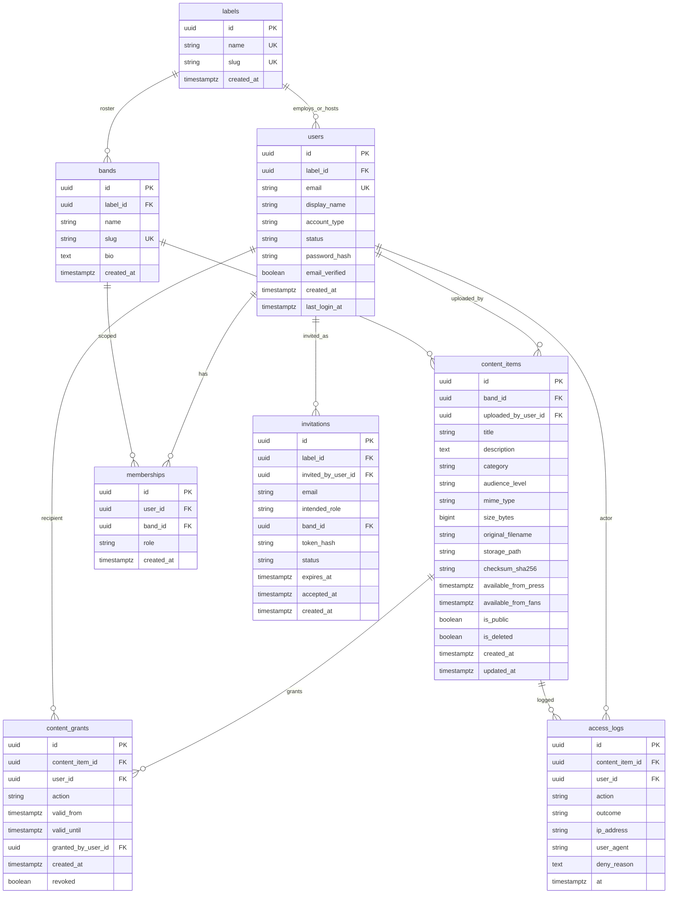

# Data model

PostgreSQL is the system of record for metadata, grants, and audit. Files live on a volume; the DB stores paths (and later wrapped encryption keys — deferred).

**Tenancy:** one label (SNAP Records). **Roster now:** one band (SNAP). Schema remains multi-band-ready.

## ER diagram

## Enumerations

### `users.account_type`

| Value | Meaning |
|-------|---------|
| `professional` | Created via invitation |
| `fan` | Self-registered |

### `users.status`

| Value | Meaning |
|-------|---------|
| `pending` | Invited or unverified |
| `active` | Can sign in |
| `disabled` | Blocked |

### `memberships.role`

| Value | Maps to Delivery 01 |
|-------|---------------------|
| `administrator` | Label staff (band_id may be null — see notes) |
| `band_member` | Band Member |
| `crew` | Crew / Management |
| `press` | Press / Partner |
| `fan_club` | Fan club member |
| `registered` | Registered user (optional membership; public-only users may have no band membership) |

**Administrator note:** Admins are label staff. Prefer either:

- `memberships` with `role = administrator` and `band_id NULL`, plus a check that only this role allows null `band_id`, or  
- a separate `label_roles` table  

**Chosen design:** `memberships.band_id` is **nullable**; null only when `role = administrator` (label-wide). All other roles require a non-null `band_id`.

### `content_items.category`

See [CONTENT_TYPES.md](CONTENT_TYPES.md). Values:

`demo`, `stem`, `master`, `lyrics`, `setlist`, `tour_rider`, `contract`, `photo`, `video`, `press_kit`, `schedule`, `other`

### `content_items.audience_level`

| Value | Meaning |
|-------|---------|
| `public` | Visible to registered users (and anyone allowed public) |
| `fan_club` | Fan club (after fan window) |
| `press` | Press/partners (after press window) |
| `crew` | Crew / management |
| `band` | Band members (and admins only if granted) |
| `restricted` | Explicit grants only |

### `content_grants.action` / `access_logs.action`

`view` | `stream` | `download` | `manage`

### `access_logs.outcome`

`allowed` | `denied`

### `invitations.status`

`pending` | `accepted` | `expired` | `revoked`

## Table details

### `labels`

| Column | Type | Constraints |
|--------|------|-------------|
| id | UUID | PK |
| name | TEXT | NOT NULL, UNIQUE |
| slug | TEXT | NOT NULL, UNIQUE |
| created_at | TIMESTAMPTZ | NOT NULL, default now() |

**Seed:** `name = 'SNAP Records'`, `slug = 'snap-records'`.

### `bands`

| Column | Type | Constraints |
|--------|------|-------------|
| id | UUID | PK |
| label_id | UUID | FK → labels, NOT NULL |
| name | TEXT | NOT NULL |
| slug | TEXT | NOT NULL, UNIQUE |
| bio | TEXT | nullable |
| created_at | TIMESTAMPTZ | NOT NULL, default now() |

**Seed:** `name = 'SNAP'`, `slug = 'snap'`, `label_id` → SNAP Records.

### `users`

| Column | Type | Constraints |
|--------|------|-------------|
| id | UUID | PK |
| label_id | UUID | FK → labels, NOT NULL |
| email | CITEXT/TEXT | NOT NULL, UNIQUE |
| display_name | TEXT | NOT NULL |
| account_type | TEXT | NOT NULL, check enum |
| status | TEXT | NOT NULL, check enum |
| password_hash | TEXT | nullable until set; security algo deferred |
| email_verified | BOOLEAN | NOT NULL, default false |
| created_at | TIMESTAMPTZ | NOT NULL |
| last_login_at | TIMESTAMPTZ | nullable |

All users belong to the single label for scoping. OAuth subject IDs can be added later without changing core FKs.

### `memberships`

| Column | Type | Constraints |
|--------|------|-------------|
| id | UUID | PK |
| user_id | UUID | FK → users, NOT NULL |
| band_id | UUID | FK → bands, nullable (admin only) |
| role | TEXT | NOT NULL, check enum |
| created_at | TIMESTAMPTZ | NOT NULL |

**Unique:** `(user_id, band_id, role)` with a partial unique strategy for null `band_id` (e.g. unique `(user_id, role)` where `band_id IS NULL`).

A user may hold multiple memberships (e.g. press on SNAP only).

### `invitations`

| Column | Type | Constraints |
|--------|------|-------------|
| id | UUID | PK |
| label_id | UUID | FK → labels |
| invited_by_user_id | UUID | FK → users |
| email | TEXT | NOT NULL |
| intended_role | TEXT | NOT NULL |
| band_id | UUID | FK → bands, nullable for admin invites |
| token_hash | TEXT | NOT NULL, UNIQUE |
| status | TEXT | NOT NULL |
| expires_at | TIMESTAMPTZ | NOT NULL |
| accepted_at | TIMESTAMPTZ | nullable |
| created_at | TIMESTAMPTZ | NOT NULL |

Used to create professional accounts. Store only a hash of the invite token.

### `content_items`

| Column | Type | Constraints |
|--------|------|-------------|
| id | UUID | PK |
| band_id | UUID | FK → bands, NOT NULL |
| uploaded_by_user_id | UUID | FK → users, NOT NULL |
| title | TEXT | NOT NULL |
| description | TEXT | nullable |
| category | TEXT | NOT NULL |
| audience_level | TEXT | NOT NULL |
| mime_type | TEXT | nullable |
| size_bytes | BIGINT | nullable |
| original_filename | TEXT | nullable |
| storage_path | TEXT | NOT NULL |
| checksum_sha256 | TEXT | nullable |
| available_from_press | TIMESTAMPTZ | nullable |
| available_from_fans | TIMESTAMPTZ | nullable |
| is_public | BOOLEAN | NOT NULL, default false |
| is_deleted | BOOLEAN | NOT NULL, default false |
| created_at | TIMESTAMPTZ | NOT NULL |
| updated_at | TIMESTAMPTZ | NOT NULL |

Soft delete via `is_deleted`. Encryption key columns are **intentionally omitted** until the security phase.

### `content_grants`

| Column | Type | Constraints |
|--------|------|-------------|
| id | UUID | PK |
| content_item_id | UUID | FK → content_items |
| user_id | UUID | FK → users |
| action | TEXT | NOT NULL |
| valid_from | TIMESTAMPTZ | nullable (immediate if null) |
| valid_until | TIMESTAMPTZ | nullable (open-ended if null) |
| granted_by_user_id | UUID | FK → users |
| created_at | TIMESTAMPTZ | NOT NULL |
| revoked | BOOLEAN | NOT NULL, default false |

Explicit allow for a user/action inside a time window. Revoke by setting `revoked = true` (keep history).

### `access_logs`

| Column | Type | Constraints |
|--------|------|-------------|
| id | UUID | PK |
| content_item_id | UUID | FK → content_items, nullable if item missing |
| user_id | UUID | FK → users, nullable for anonymous attempts if ever allowed |
| action | TEXT | NOT NULL |
| outcome | TEXT | NOT NULL |
| ip_address | TEXT | nullable |
| user_agent | TEXT | nullable |
| deny_reason | TEXT | nullable |
| at | TIMESTAMPTZ | NOT NULL, default now() |

Append-only. Do not update or delete in normal operation.

## Indexes (recommended)

| Table | Index |
|-------|--------|
| users | UNIQUE(email) |
| bands | UNIQUE(slug); INDEX(label_id) |
| memberships | INDEX(user_id); INDEX(band_id); INDEX(role) |
| content_items | INDEX(band_id); INDEX(category); INDEX(audience_level); INDEX(is_deleted) |
| content_grants | INDEX(content_item_id); INDEX(user_id); INDEX(revoked) |
| access_logs | INDEX(content_item_id, at DESC); INDEX(user_id, at DESC) |
| invitations | UNIQUE(token_hash); INDEX(email, status) |

## Seed data expectations

| Entity | Value |
|--------|--------|
| Label | SNAP Records / `snap-records` |
| Band | SNAP / `snap` |
| Users | At least one admin; optional sample band member, crew, press, fan_club, registered |

## Deferred columns (security phase — do not add yet)

- File DEK wrapped ciphertext on `content_items`
- Encrypted PII columns + email lookup hash on `users`
- TOTP secrets, OAuth subject, Keycloak ids

## Related docs

- [CONTENT_TYPES.md](CONTENT_TYPES.md)  
- [ACCESS_CONTROL.md](ACCESS_CONTROL.md)  
- [ARCHITECTURE.md](ARCHITECTURE.md)  
