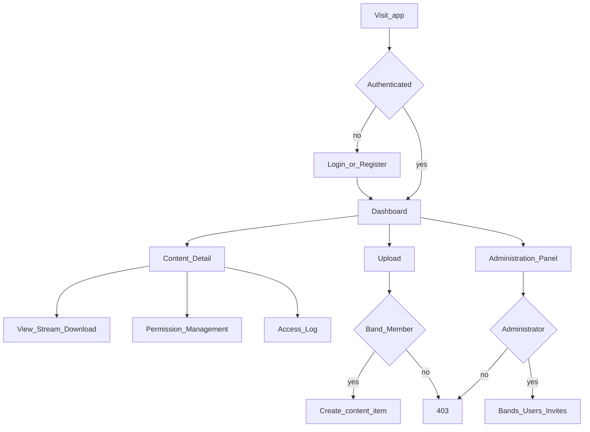

# Pages & user flows

Pages required by Delivery 01, framed for SNAP Records. Implementation comes in Phase 2; this doc is the UI/route contract.

## Page inventory

| Page | Route (suggested) | Description | Availability |
|------|-------------------|-------------|--------------|
| Login | `/login` | Sign in with email/password (professionals and fans for now; Google OAuth deferred) | Everybody (unauthenticated) |
| Registration | `/register` | Fan self-registration | Everybody (unauthenticated) |
| Accept invitation | `/invite/<token>` | Professional account setup from admin invite | Invitees |
| Dashboard | `/` or `/dashboard` | Lists content the user may see; group by band and category | All authenticated users |
| Content Detail | `/content/<id>` | Metadata; view / stream / download if allowed | Users with access to the item |
| Upload | `/content/upload` | Upload file; set band, category, audience, press/fan availability | Band members (SNAP) |
| Edit content | `/content/<id>/edit` | Modify metadata or replace file; soft-delete | Band members (owner band) |
| Permission Management | `/content/<id>/permissions` | Change audience level, availability dates; grant/revoke users | Band members (owner band) |
| Access Log | `/content/<id>/log` or `/logs` | History of view/stream/download including denials | Band members (own band), administrators |
| Administration Panel | `/admin` | Manage bands, invitations, users, roles | Administrators |

## Role × page matrix

| Page | Admin | Band Member | Crew | Press | Fan club | Registered |
|------|:-----:|:-----------:|:----:|:-----:|:--------:|:----------:|
| Login / Register | Y | Y | Y | Y | Y | Y |
| Dashboard | Y | Y | Y | Y | Y | Y |
| Content Detail | if granted | own band + allowed | allowed | allowed | allowed | public only |
| Upload | N* | Y (SNAP) | N | N | N | N |
| Permissions | N* | Y (own band) | N | N | N | N |
| Access Log | Y | Y (own band) | N | N | N | N |
| Admin Panel | Y | N | N | N | N | N |

\*Admins do not get content open/upload by role alone; they need an explicit grant or a separate band membership if they also act as staff on content.

## Primary navigation flow

## Dashboard behavior

1. Resolve current user memberships and roles.
2. Query `content_items` for band SNAP (and future bands) where `can_access(user, item, view)`.
3. Group results by **band** then **category** (see [CONTENT_TYPES.md](CONTENT_TYPES.md)).
4. Hide soft-deleted items from non-admins (admins may see deleted in admin tools only if needed later).

## Content Detail behavior

- Show title, description, category, audience, availability windows, uploader, band.
- Action buttons (View / Stream / Download) only if `can_access` allows that action.
- Band members of the owner band also see links to Permissions, Edit, Access Log.
- Every attempted action writes an `access_logs` row (allowed or denied).

## Upload behavior

- Band selector: for now fixed to **SNAP** (only roster band).
- Required: title, category, audience level, file.
- Optional: description, `available_from_press`, `available_from_fans`, `is_public`.
- Store file on volume; save `storage_path`, mime, size, checksum.

## Permission Management behavior

- Edit `audience_level`, `available_from_press`, `available_from_fans`, `is_public`.
- List existing `content_grants`; add grant (user, action, valid_from/until); revoke grant.
- Only band members of the content's band (not press/fans).

## Access Log behavior

- Filter by content item and/or date.
- Columns: time, user, action, outcome, deny_reason, IP (if stored).
- Band members: items for SNAP only. Admins: all items.

## Administration Panel behavior

- List/create bands (UI ready for more bands; seed remains SNAP only).
- Invite professional users (email, intended role, band).
- Assign/change memberships and roles; verify / disable accounts.
- Admins cannot open band content from this panel alone.

## Auth notes (Phase 2 vs deferred)

| Now (Phase 2) | Later (Phase 3) |
|---------------|-----------------|
| Email + password session | Fan Google OAuth / OIDC |
| No 2FA | TOTP for privileged roles |
| Invite token in link | Same flow; harden token storage |

## Related docs

- [ACCESS_CONTROL.md](ACCESS_CONTROL.md)  
- [DATA_MODEL.md](DATA_MODEL.md)  
- [PLAN.md](PLAN.md)  
