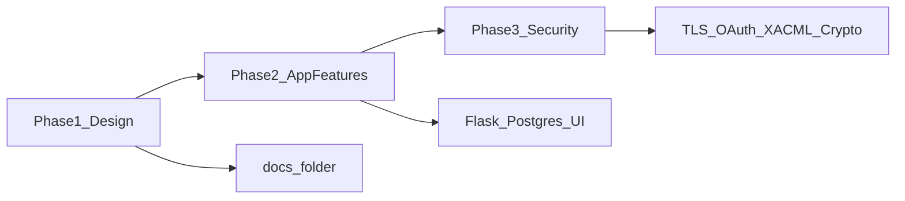

# SNAP Records — Product & technical plan

## Framing

The Delivery 01 brief describes a private platform for record labels. This project instantiates that as **one** label:

- **Label:** SNAP Records
- **Band (now):** SNAP
- **Problem:** Sensitive material is shared by email today; email cannot revoke access, cannot enforce embargoes, and leaves no audit trail
- **Solution:** Per-user, per-role, per-band, per-time-window access to label content, with an access log

This is SNAP Records' internal portal, not a public fan marketing site and not a multi-label SaaS.

## Goals (software features)

Aligned with Delivery 01 required and optional functionality:

| Feature | Notes |
|---------|--------|
| User login | Professional: username/password (simple for now). Fan OAuth deferred |
| Role-based access to restricted resources | See [ACCESS_CONTROL.md](ACCESS_CONTROL.md) |
| Upload docs/resources | Band members; set band, category, permissions, availability dates |
| Manage access permissions | Audience level, availability windows, grant/revoke users |
| Fan registration | Optional; self-register as fan/registered user |
| Modify / delete existing resources | Band members for their band's content |
| Access log | Who viewed, streamed, downloaded; include denied attempts |
| Administration panel | Bands, invitations, users, roles |

## Non-goals (this phase and security deferral)

**Design phase (current):** documentation and diagrams only — no app code.

**Security features — deferred (do not implement until a later phase):**

| Feature | Planned later (from Delivery 01) |
|---------|----------------------------------|
| Server certificate (TLS) | Own CA + OpenSSL; Nginx HTTPS; Secure/HttpOnly/SameSite cookies |
| OAuth 2.0 / OIDC | Fan Google login via Authlib; Keycloak under evaluation |
| XACML 3.0 / AuthzForce | Policy decisions for content access |
| Password hashing / 2FA | Argon2id, rate limiting, TOTP for privileged roles |
| Content encryption at rest | AES-256-GCM per file; wrapped keys in DB; master key in Docker secrets |
| Partial DB encryption | Field-level AES-GCM for sensitive columns; searchable email hash |
| Watermarking | Recipient identity in downloads / links |
| Security CI | Bandit, Semgrep, Gitleaks, Trivy, pip-audit, OWASP ZAP |

Functional placeholders: plain session login, plaintext or simple password storage for prototyping only, unencrypted file storage, in-app `can_access` rules (not XACML).

## Users and roles

Two account types:

1. **Professional** — created by admin invitation
2. **Fan** — self-registration

| Role | Who | Functional permissions |
|------|-----|------------------------|
| Administrator | Label staff | Create bands, invite users, assign roles, verify accounts. No band content unless granted |
| Band Member | Musicians | Upload/edit/delete their band's content; manage permissions; view access logs for their band |
| Crew / Management | Tour managers, technicians | Access schedules and tour info for linked bands |
| Press / Partner | Journalists, producers, radio | Music/material allowed to them, after press availability date (or explicit grant) |
| Fan club member | Band subscribers | Pre-release, behind-the-scenes, early announcements after fan availability |
| Registered user | Account holders | Public content only |

## Pages (summary)

Full inventory: [PAGES.md](PAGES.md).

1. Login / Registration  
2. Dashboard  
3. Content Detail  
4. Upload  
5. Permission Management  
6. Access Log  
7. Administration Panel  

## Target stack (planned, not built in design phase)

| Component | Technology | Goal |
|-----------|------------|------|
| Reverse proxy | Nginx | TLS termination / headers (later) |
| Web app | Python (Flask) | UI, auth, business logic |
| Database | PostgreSQL | Users, bands, content, grants, access log |
| Authorization | In-app policy now; AuthzForce later | Allow/deny content actions |
| File storage | Docker volume | Uploaded files (unencrypted until security phase) |
| Secrets | Env / Docker secrets later | DB credentials; crypto keys later |

## Schema stance

- Single label row: SNAP Records (no multi-tenancy)
- `bands` table exists; seed only **SNAP**
- Adding another roster band later should not require a redesign

## Roadmap

1. **Phase 1 — Design (done):** this `docs/` set  
2. **Phase 2 — App features:** Flask + PostgreSQL + pages + functional access + access log + admin  
3. **Phase 3 — Security:** pick 4–6 Delivery 01 security features and implement  

## Related docs

- [AGENT.md](AGENT.md) — agent entrypoint  
- [ARCHITECTURE.md](ARCHITECTURE.md) — components  
- [DATA_MODEL.md](DATA_MODEL.md) — schema  
- [PAGES.md](PAGES.md) — UI flows  
- [ACCESS_CONTROL.md](ACCESS_CONTROL.md) — authorization rules  
- [CONTENT_TYPES.md](CONTENT_TYPES.md) — content taxonomy  
